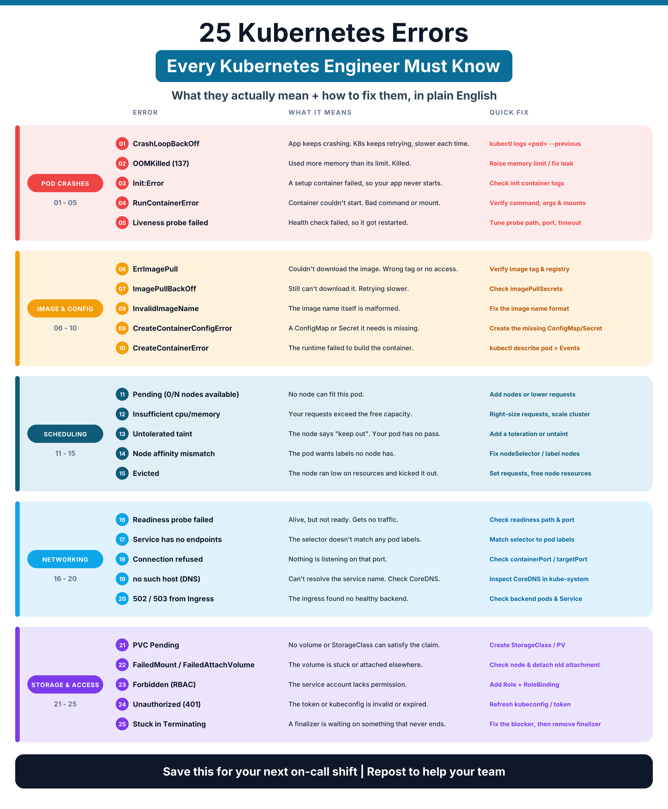

<div align="center">

# 25 Kubernetes Errors Explained

**What they actually mean, how to diagnose them, and how to fix them, in plain English.**




</div>

---

## Why this repo?

It is 2 AM and a pod is red. The error name looks like a riddle. This repo is a practical cheat sheet for the **25 most common Kubernetes errors**, grouped into 5 categories. Every error has:

- A plain-English meaning
- The most common causes
- `kubectl` commands to diagnose it
- Steps to fix it
- (For many of them) a broken manifest you can apply to practice on a test cluster

## The 25 errors

| # | Error | What it means | Guide |
|---|-------|---------------|-------|
| 01 | `CrashLoopBackOff` | App keeps crashing. K8s keeps retrying, slower each time. | [Pod Crashes](docs/01-pod-crashes.md#01-crashloopbackoff) |
| 02 | `OOMKilled (137)` | Used more memory than its limit. Killed. | [Pod Crashes](docs/01-pod-crashes.md#02-oomkilled-137) |
| 03 | `Init:Error` | A setup container failed, so your app never starts. | [Pod Crashes](docs/01-pod-crashes.md#03-initerror) |
| 04 | `RunContainerError` | Container couldn't start. Bad command or mount. | [Pod Crashes](docs/01-pod-crashes.md#04-runcontainererror) |
| 05 | `Liveness probe failed` | Health check failed, so it got restarted. | [Pod Crashes](docs/01-pod-crashes.md#05-liveness-probe-failed) |
| 06 | `ErrImagePull` | Couldn't download the image. Wrong tag or no access. | [Image & Config](docs/02-image-and-config.md#06-errimagepull) |
| 07 | `ImagePullBackOff` | Still can't download it. Retrying slower. | [Image & Config](docs/02-image-and-config.md#07-imagepullbackoff) |
| 08 | `InvalidImageName` | The image name itself is malformed. | [Image & Config](docs/02-image-and-config.md#08-invalidimagename) |
| 09 | `CreateContainerConfigError` | A ConfigMap or Secret it needs is missing. | [Image & Config](docs/02-image-and-config.md#09-createcontainerconfigerror) |
| 10 | `CreateContainerError` | The runtime failed to build the container. | [Image & Config](docs/02-image-and-config.md#10-createcontainererror) |
| 11 | `Pending (0/N nodes available)` | No node can fit this pod. | [Scheduling](docs/03-scheduling.md#11-pending-0n-nodes-available) |
| 12 | `Insufficient cpu/memory` | Your requests exceed the free capacity. | [Scheduling](docs/03-scheduling.md#12-insufficient-cpumemory) |
| 13 | `Untolerated taint` | The node says "keep out". Your pod has no pass. | [Scheduling](docs/03-scheduling.md#13-untolerated-taint) |
| 14 | `Node affinity mismatch` | The pod wants labels no node has. | [Scheduling](docs/03-scheduling.md#14-node-affinity-mismatch) |
| 15 | `Evicted` | The node ran low on resources and kicked it out. | [Scheduling](docs/03-scheduling.md#15-evicted) |
| 16 | `Readiness probe failed` | Alive, but not ready. Gets no traffic. | [Networking](docs/04-networking.md#16-readiness-probe-failed) |
| 17 | `Service has no endpoints` | The selector doesn't match any pod labels. | [Networking](docs/04-networking.md#17-service-has-no-endpoints) |
| 18 | `Connection refused` | Nothing is listening on that port. | [Networking](docs/04-networking.md#18-connection-refused) |
| 19 | `no such host (DNS)` | Can't resolve the service name. Check CoreDNS. | [Networking](docs/04-networking.md#19-no-such-host-dns) |
| 20 | `502 / 503 from Ingress` | The ingress found no healthy backend. | [Networking](docs/04-networking.md#20-502--503-from-ingress) |
| 21 | `PVC Pending` | No volume or StorageClass can satisfy the claim. | [Storage & Access](docs/05-storage-and-access.md#21-pvc-pending) |
| 22 | `FailedMount / FailedAttachVolume` | The volume is stuck or attached elsewhere. | [Storage & Access](docs/05-storage-and-access.md#22-failedmount--failedattachvolume) |
| 23 | `Forbidden (RBAC)` | The service account lacks permission. | [Storage & Access](docs/05-storage-and-access.md#23-forbidden-rbac) |
| 24 | `Unauthorized (401)` | The token or kubeconfig is invalid or expired. | [Storage & Access](docs/05-storage-and-access.md#24-unauthorized-401) |
| 25 | `Stuck in Terminating` | A finalizer is waiting on something that never ends. | [Storage & Access](docs/05-storage-and-access.md#25-stuck-in-terminating) |

## The 3-step debug routine

Most problems become obvious with these three commands:

```bash
# 1. What is the status?
kubectl get pods -n <namespace>

# 2. What do the Events say? (read the bottom of the output)
kubectl describe pod <pod> -n <namespace>

# 3. Why did the last container die?
kubectl logs <pod> -n <namespace> --previous
```

Also useful:

```bash
kubectl get events -n <namespace> --sort-by=.lastTimestamp
kubectl top pod <pod> -n <namespace> --containers
kubectl get pod <pod> -n <namespace> -o yaml
```

## Repo structure

```
.
├── README.md
├── assets/                  # Infographic (PNG + SVG)
├── docs/                    # One guide per category, all 25 errors
│   ├── 01-pod-crashes.md
│   ├── 02-image-and-config.md
│   ├── 03-scheduling.md
│   ├── 04-networking.md
│   └── 05-storage-and-access.md
├── examples/                # Intentionally broken manifests to practice with
├── scripts/
│   └── debug-pod.sh         # Collects status, events, logs and node info for a pod
├── CONTRIBUTING.md
└── LICENSE
```

## Practice on a test cluster

```bash
git clone https://github.com/<your-username>/kubernetes-25-errors-explained.git
cd kubernetes-25-errors-explained

kubectl create namespace k8s-errors-lab
kubectl apply -n k8s-errors-lab -f examples/crashloopbackoff.yaml
kubectl get pods -n k8s-errors-lab -w

# Clean up
kubectl delete namespace k8s-errors-lab
```

> Use kind, minikube, k3d or a lab cluster. Do not apply the examples to production.

## Debug helper script

```bash
./scripts/debug-pod.sh <pod> <namespace>
```

It saves the pod status, manifest, `describe` output, events, logs (current and previous, including init containers) and node details into a `debug-<pod>-<timestamp>/` folder you can attach to a ticket.

## Contributing

Contributions are welcome: fix a typo, add a cause, or add a new error. See [CONTRIBUTING.md](CONTRIBUTING.md).

## License

[MIT](LICENSE)

---

If this helped you, give the repo a star and share it with your team.
